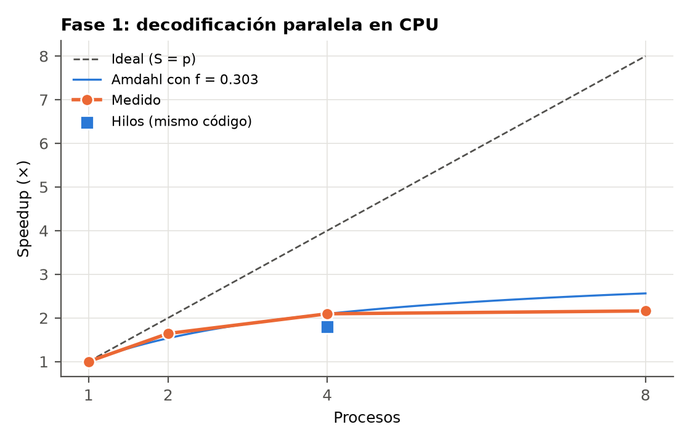
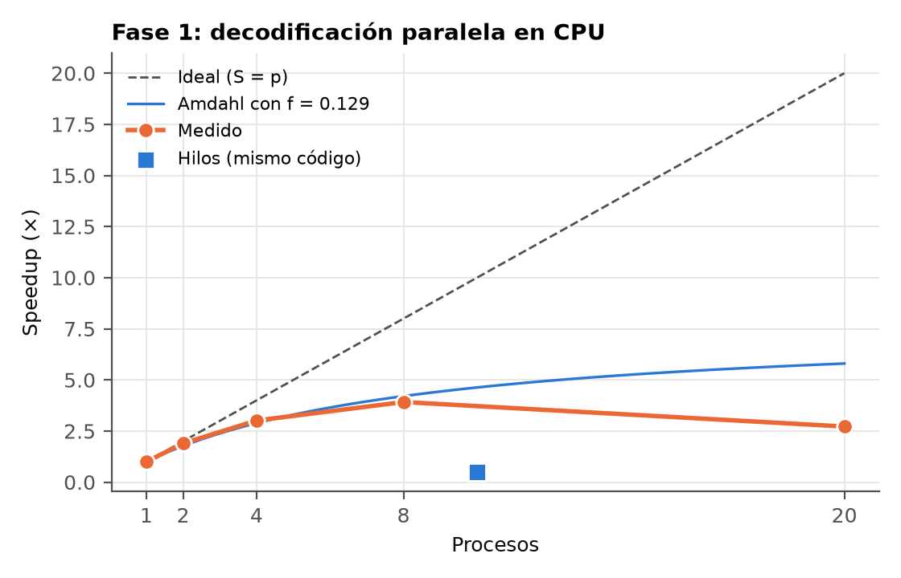
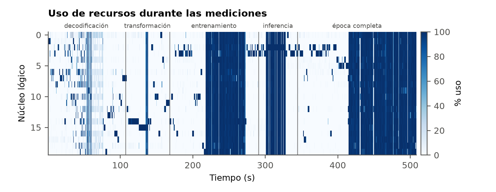
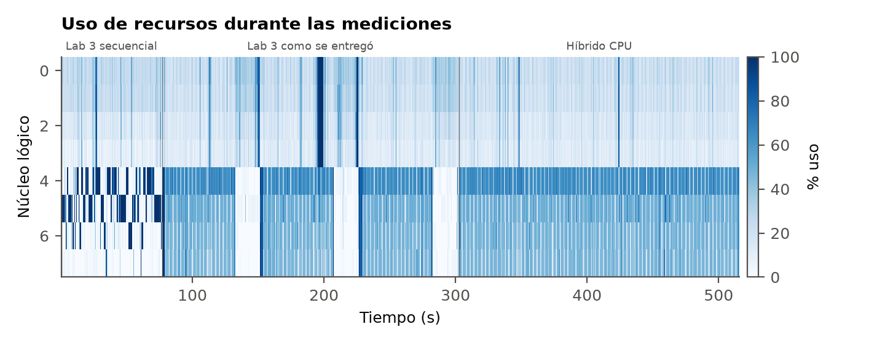
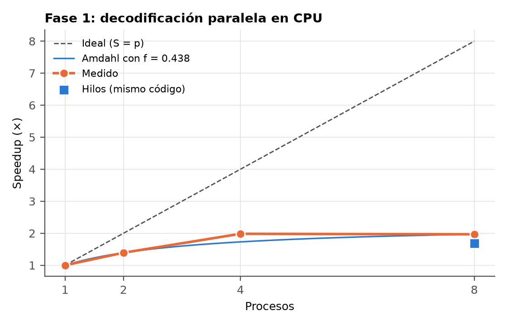
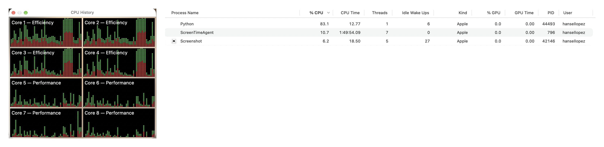
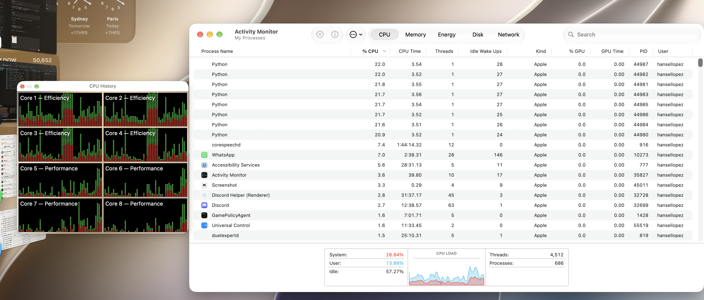

# 2. Medición del tiempo de ejecución secuencial

## 2.1 Procedimiento

Todas las mediciones usan el mismo subconjunto de imágenes: 40 por clase
(1,160 en total) tomadas a intervalos iguales a lo largo de cada video de la
partición de entrenamiento, y 200 por clase (5,800) para la fase de
decodificación, donde con menos imágenes el arranque de los procesos tapa el
resultado. El subconjunto es determinista, así que cualquier computadora mide
exactamente las mismas imágenes.

Cada variante se ejecuta una vez como calentamiento (se descarta) y luego 5
veces seguidas (3 en la época completa). El calentamiento absorbe la
compilación JIT de Numba, la selección de algoritmos de cuDNN y la primera
lectura de los archivos desde el disco. Reportamos media, desviación estándar
y coeficiente de variación (CV).

Medimos cada fase por separado y además una época completa de punta a punta:

| Fase | Línea base secuencial | Variantes paralelas en CPU | Qué se mide |
|---|---|---|---|
| Decodificación (fase 1) | 1 proceso | 2, 4, 8 procesos y todos los núcleos lógicos; hilos con el mismo código | Leer el JPEG, decodificar, pasar a RGB y escribir en la caché |
| Transformación de entrada | torchvision con PIL, una imagen a la vez (Lab 3) | Kernel Numba en CPU con 1 hilo y con todos | Recorte, rotación, perspectiva, color, normalización y borrado |
| Paso de entrenamiento | PyTorch en 1 hilo | PyTorch con todos los hilos | Forward, pérdida, backward y AdamW sobre lotes de 64 |
| Inferencia | 1 hilo, lote de 64 y una sola imagen | Todos los hilos | Forward sin gradientes |
| Época completa | Código del Lab 3 con 0 *workers* y 1 hilo | Lab 3 como se entregó (4 *workers*, todos los hilos); caché + kernel Numba en CPU | Todo lo anterior junto |

Condiciones: laptop conectada a la corriente, perfil de energía de máximo
rendimiento, sin otras aplicaciones abiertas y la misma versión del código
(commit registrado en `environment.json`). Comando:
`asl-cuda bench --tag <equipo>`; los datos crudos quedan en
`results/<equipo>/bench/` y el uso de cada núcleo, medido cada 0.25 s, en
`results/<equipo>/bench/monitor.csv`.

Medimos en tres computadoras. Los números oficiales, y todos los speedup del
informe, son de la laptop de Adrian, porque ahí se mide también la GPU y el
speedup solo tiene sentido dentro de la misma máquina. Las otras dos sirven
para ver cómo cambia el escalamiento en CPU con otra arquitectura:

| Equipo | Procesador | Núcleos | RAM | Sistema |
|---|---|---|---|---|
| Laptop de Fernando | AMD Ryzen AI 9 365 | 10 físicos (4 Zen 5 y 6 Zen 5c), 20 lógicos | 15.3 GB visibles en WSL2 | Linux en WSL2 sobre Windows |
| MacBook de Hansel | Apple M3 | 8 (4 de rendimiento y 4 de eficiencia) | 24 GB | macOS |

## 2.2 Resultados en la laptop de la corrida oficial

Equipo: [[GPU: modelo de CPU, núcleos físicos/lógicos y RAM de `environment.json`]].

### Época completa

: Época completa con 1,160 imágenes en la laptop oficial (media de 3 repeticiones).



La versión original del Lab 3 en un solo hilo procesa
[[GPU: img/s de "Lab 3 secuencial" en pipeline.md]] imágenes por segundo. De
cada época, [[GPU: % = data_seconds / seconds de "Lab 3 secuencial" en
bench_pipeline.csv]] del tiempo se va en leer y transformar imágenes y el
resto en la red.

Si se proyecta linealmente al entrenamiento completo (43,500 imágenes por
época y el máximo de 14 épocas de la receta), el tiempo queda así:

: Proyección del entrenamiento completo en la laptop oficial.



### Decodificación

: Decodificación de 5,800 imágenes según el número de procesos (media de 5 repeticiones).



{width=72%}

[[GPU: 2 o 3 oraciones sobre prep.md: hasta cuántos procesos el speedup sigue
la línea ideal, dónde se aplana y qué pasa con Karp-Flatt.]]

Las variantes en CPU de la transformación de entrada, del paso de
entrenamiento y de la inferencia están en las tablas de la sección 5.3, junto
a las de GPU, para que la comparación quede en un solo lugar.

## 2.3 Resultados en la laptop de Fernando (Ryzen AI 9 365)

Esta corrida se hizo con la laptop conectada, sin otras aplicaciones y sin
usarla mientras corría. El monitor lo confirma: durante las variantes de un
solo hilo el uso total del CPU fue de 5.4 %, que es justo un núcleo lógico de
20; no había otra carga.

: Época completa en la Ryzen (1,160 imágenes, media de 3 repeticiones).



El Lab 3 en un hilo procesa 44.9 imágenes por segundo. De los 25.8 s de la
época, 5.4 s (21 %) son abrir, decodificar y transformar imágenes y 20.4 s son
la red. Con la configuración con la que se entregó (4 *workers* y todos los
hilos) la época baja a 15.5 s, un speedup de 1.67, y la parte de datos casi
desaparece del hilo principal (1.05 s) porque la hacen los *workers* en
paralelo. Con la caché y el kernel de Numba en CPU baja a 9.4 s (2.75×).

Esa última fila tiene un CV de 26 %: la primera repetición tardó 6.5 s y las
dos siguientes 10.8 y 10.9 s. Las tres usan los 20 hilos lógicos al 96 %
durante más de 30 s seguidos, y lo más probable es que la laptop haya bajado
la frecuencia por temperatura. Desde WSL2 no pudimos leer la frecuencia del
procesador para confirmarlo, así que lo dejamos como hipótesis; es también
un aviso para la corrida en GPU, que corre en otra laptop con el mismo
problema.

: Proyección del entrenamiento completo en la Ryzen.



Con la caché y el kernel en CPU, el entrenamiento completo pasaría de 3.77
a 1.38 horas sin usar GPU. Es la ganancia de hacer la decodificación una sola
vez y de reemplazar PIL por el kernel, antes de cualquier aceleración en la
GPU.

: Paso de entrenamiento, inferencia y transformación de entrada en la Ryzen.







Aquí los hilos de PyTorch sí ayudan, pero poco: el paso de entrenamiento
mejora 1.45 veces con 20 hilos, aunque el monitor muestra los 20 hilos
lógicos al 96 %. En Linux, PyTorch usa OpenMP y sus hilos esperan activamente
(*spin*) en cada barrera entre operaciones, así que un núcleo ocupado no
significa un núcleo haciendo trabajo útil. Con una sola imagen, 20 hilos son
más lentos que uno (9.4 ms contra 5.3 ms): cada capa tiene tan poco trabajo
que coordinar los hilos cuesta más que el cálculo.

El kernel de Numba, en cambio, ya es 2.3 veces más rápido que torchvision con
PIL en un solo hilo, y con 20 hilos llega a 12.5 veces. Es la fase que mejor
escala en CPU porque cada lote es un solo `prange` grande, sin barreras
intermedias.

: Decodificación de 5,800 imágenes en la Ryzen.



{width=70%}

La decodificación escala bien hasta 4 procesos (3.0×, eficiencia 0.75) y
llega a su máximo con 8 (3.9×). Con 20 procesos baja a 2.7×. Karp-Flatt
crece de forma sostenida, de 0.055 con 2 procesos a 0.33 con 20: el límite no
es una parte secuencial del algoritmo sino el costo de paralelizar. A partir
de 10 procesos se empiezan a usar los hilos lógicos (dos por núcleo físico,
que comparten unidades de cálculo) y 6 de los 10 núcleos son Zen 5c, de menor
frecuencia. Además, 5,800 imágenes se reparten en bloques muy pequeños entre
20 procesos, y arrancar cada uno pesa. Con el dataset completo sí conviene usar
todos: `asl-cuda prep` armó la caché de las 66,700 imágenes en 73.5 s con un
proceso y en 15.8 s con 20 (4.65×). Parte de esa diferencia no es
paralelismo: la corrida de un proceso fue la primera y leyó los JPEG desde el
disco (907 imágenes por segundo, contra 1,686 en la medición con
calentamiento).

Los hilos, con el mismo código, fueron más lentos que la versión secuencial:
speedup de 0.51 con 10 hilos. Es el efecto del GIL.

{width=95%}

## 2.4 Resultados en la MacBook de Hansel (Apple M3)

En la M3 las mediciones se hicieron con algunas aplicaciones abiertas en
segundo plano. El monitor lo muestra: aun en la variante de un solo hilo, los
cuatro núcleos de eficiencia estaban entre 12 y 28 % ocupados. Por eso usamos
estos números para comparar cómo escala cada fase y no como tiempos absolutos;
la referencia limpia en CPU es la de la sección anterior.

: Época completa en la M3 (1,160 imágenes, media de 3 repeticiones).



Una época del Lab 3 en un hilo procesa 45.4 imágenes por segundo, y de los
25.5 s que tarda con 1,160 imágenes solo 1.8 s son lectura y transformación;
los otros 23.7 s son la red. En esta máquina el costo de la versión
secuencial está casi todo en el cálculo, no en los archivos.

Lo que más nos sorprendió fue que la configuración con la que se entregó el
Lab 3 (4 *workers* y 8 hilos) es 3 veces más lenta que la secuencial: 75.0 s
contra 25.5 s. La mayor parte de la diferencia está en la red, que pasó de
23.7 s a 52.8 s de cálculo, y otros 20 s de cada repetición no son ni datos
ni cálculo: en el monitor se ven como franjas en blanco al inicio de cada
repetición, mientras arrancan los 4 procesos del `DataLoader`.

: Paso de entrenamiento en la M3 (15 lotes de 64).



: Inferencia en la M3, por lotes y de una sola imagen.



El paso de entrenamiento confirma que el problema son los hilos de PyTorch:
con 8 hilos tarda 64.2 s contra 21.9 s con uno (speedup 0.34) y con un CV de
11 %, contra 2.7 % en un hilo. Para una sola imagen la latencia sube de 16 ms
a 82 ms.

{width=95%}

La figura explica por qué. Con 8 hilos el uso total del CPU fue de 31 a 33 %
en promedio, y los núcleos de rendimiento promediaron entre 32 y 59 %: los
hilos pasan la mayor parte del tiempo esperando. PyTorch reparte cada operación en
partes iguales entre sus hilos y espera a que terminen todas antes de seguir.
En la M3 la mitad de esos hilos cae en núcleos de eficiencia, que son más
lentos y además estaban compartidos con otras aplicaciones, así que los
núcleos rápidos terminan y se quedan esperando en cada capa. No lo repetimos
con 4 hilos, que es lo que indicaría este razonamiento.

En cambio, el kernel de Numba en CPU sí escala en la misma máquina:

: Transformación de entrada en la M3 (1,160 imágenes).



Pasa de 1.58 s con un hilo a 0.44 s con 8 (3.6 veces), y queda 3.8 veces más
rápido que torchvision con PIL. La diferencia con PyTorch es que el trabajo
del kernel es uno solo y grande por lote (un `prange` sobre 64 × 224 filas),
sin una barrera por capa.

: Decodificación de 5,800 imágenes en la M3.



{width=70%}

{width=95%}

{width=95%}

La decodificación llega a 1.98 con 4 procesos y no mejora con 8 (1.97). La
fracción serial estimada con Karp-Flatt no se mantiene constante: es 0.34 con
4 procesos y 0.44 con 8. Si el límite fuera una parte secuencial del
algoritmo, *e* sería parecida en todas las filas; que crezca significa que lo
que limita es el costo de paralelizar. Aquí ese costo pesa mucho porque la M3
decodifica 4,091 imágenes por segundo en un solo núcleo: las 5,800 imágenes
se terminan en 1.4 s, y arrancar cada proceso nuevo e importar NumPy y Pillow
toma una fracción apreciable de eso.

Con el dataset completo los registros de `asl-cuda prep` muestran lo mismo a
mayor escala: las 66,700 imágenes pasaron de 25.5 s con 1 proceso a 18.7 s
con 8. Validación y prueba se aceleraron 2.4 veces, pero entrenamiento solo
1.15 veces (de 17.9 s a 15.5 s). Entrenamiento es la partición más grande:
escribe 5.2 GB de caché, contra 1.4 GB de cada una de las otras dos.
Sospechamos que ahí el límite fue la escritura a disco, pero no lo medimos
por separado.

## 2.5 Factores que influyen en el rendimiento

**El GIL.** Los hilos de Python no ejecutan código Python al mismo tiempo.
En la Ryzen, 10 hilos decodificando fueron más lentos que uno solo (0.51×).
Pillow suelta el GIL durante parte de la decodificación, y en la M3 los hilos
todavía dieron 1.68×, pero en las dos máquinas quedaron por debajo de los
procesos. [[GPU: speedup de la fila de hilos en prep.md de la corrida
oficial y comparación con procesos]].

**Núcleos físicos, lógicos y de distinto tipo.** Dos hilos lógicos de un
mismo núcleo físico comparten sus unidades de cálculo; en la Ryzen 6 de los
10 núcleos son Zen 5c, de menor frecuencia, y en la M3 la mitad son de
eficiencia. En los dos casos agregar trabajadores después
del número de núcleos rápidos no ayuda y puede empeorar el tiempo, sobre todo
en PyTorch, que sincroniza todos sus hilos en cada operación.

**Arranque de procesos.** En Windows y en macOS Python crea los procesos con
*spawn*: cada uno vuelve a importar las librerías. Es un costo fijo que se
nota con pocas imágenes (Karp-Flatt creciente en la decodificación) y en el
`DataLoader` del Lab 3, que lo paga al inicio de cada época.

**Temperatura.** Una laptop con todos los núcleos ocupados por mucho tiempo
baja su frecuencia. Lo vimos en la variante híbrida en la Ryzen (de 6.5 s a
10.9 s entre repeticiones); por eso reportamos el CV de cada medición.

**Caché del sistema operativo.** La primera lectura de los JPEG viene del
disco y las siguientes de la memoria. Por eso descartamos la primera
ejecución de cada variante: sin calentamiento, la variante que corre primero
sale perjudicada.

**PIL procesa una imagen a la vez.** La transformación de entrada del Lab 3
hace varias pasadas completas sobre cada imagen (recorte, rotación,
perspectiva, color) y convierte entre formatos en cada una. El kernel de
Numba hace todo en una pasada por píxel, y por eso aun en un hilo es igual o
más rápido.

**Hilos de PyTorch y *workers* del `DataLoader`.** El Lab 3 se entregó con 4
*workers* y todos los hilos. En la Ryzen esa combinación sí ayudó (1.67×),
pero en la M3 fue 3 veces más lenta que un solo hilo: el resultado depende
del procesador y no conviene suponerlo. En la laptop
oficial la diferencia entre "Lab 3 secuencial" y "Lab 3 como se entregó" fue
[[GPU: speedup de "Lab 3 como se entregó" en pipeline.md]].
