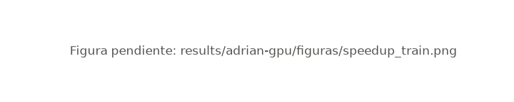
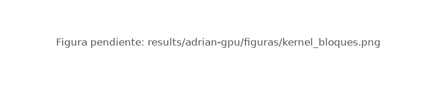
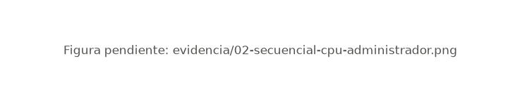
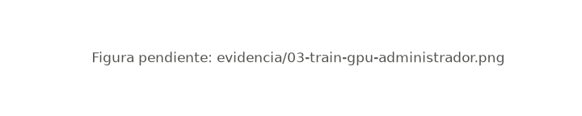

# 5. Implementación con CUDA Python

## 5.1 Entorno de ejecución

Todas las corridas de esta sección y los speedup del informe son de la laptop
de Adrian, la única del equipo con GPU NVIDIA.

| | |
|---|---|
| GPU | [[GPU: modelo, número de SM y VRAM, de `environment.json`]] |
| Driver y CUDA | [[GPU: versión del driver y "CUDA Version" de `nvidia-smi-inicial.txt`; CUDA de PyTorch de `environment.json`]] |
| CPU y RAM | [[GPU: modelo, núcleos físicos/lógicos y RAM]] |
| Sistema operativo | [[GPU: versión de Windows]] |
| Software | Python 3.12, PyTorch 2.14.1, Numba 0.68.1, numba-cuda 0.30.4 |

Condiciones: conectada a la corriente, perfil de energía de máximo
rendimiento [[GPU: y modo del software del fabricante, si aplica]], sin otras
aplicaciones abiertas y sin usar la laptop durante la corrida. Toda la
secuencia se ejecutó con un solo script (`scripts/corrida_gpu.ps1`), que
además guardó `nvidia-smi` cada segundo en `logs/nvidia-smi.csv`.

## 5.2 Componentes CUDA utilizados

| Componente | Librería | Dónde se usa |
|---|---|---|
| Kernel de entrada (`warp_kernel`) | Numba CUDA (`numba-cuda`) | `augment.py`, lanzado desde `feeders.py` |
| Interoperabilidad Numba ↔ PyTorch | `__cuda_array_interface__`, `cuda.external_stream` | `feeders.py` |
| Memoria pinned y copias asíncronas | PyTorch (`pin_memory`, `non_blocking=True`) | `feeders.py` |
| Eventos CUDA (sincronización y tiempos) | `torch.cuda.Event`, `numba.cuda.event` | `feeders.py`, `bench.py` |
| Convoluciones y productos matriciales | cuDNN y cuBLAS a través de PyTorch | `train.py` |
| Precisión mixta | `torch.autocast`, `torch.amp.GradScaler` | `train.py` |
| Telemetría de la GPU | NVML (`nvidia-ml-py`) y `nvidia-smi` | `monitor.py`, `scripts/corrida_gpu.*` |

El único código CUDA escrito por nosotros es el kernel de entrada; la red usa
las bibliotecas de NVIDIA a través de PyTorch. Así se reparte el trabajo de
un lote de entrenamiento:

1. **CPU, `CudaFeeder.__iter__`.** Toma los índices del lote, ya barajados, y
   copia esas 64 imágenes desde la caché en disco (abierta con *memory map*)
   a uno de los dos buffers *pinned* de 7.7 MB. Antes espera el evento CUDA
   de ese buffer, que indica que su copia anterior ya terminó. Después genera
   en el CPU los 16 parámetros de cada imagen (`sample_params` en
   `augment.py`).
2. **Copia H2D.** `.to(device, non_blocking=True)` encola la copia del
   buffer y de los parámetros en el stream de PyTorch y vuelve de inmediato. Como la memoria es
   *pinned*, la copia la hace el motor DMA de la GPU sin pasar por el CPU.
3. **Kernel.** `launch_warp` lanza `warp_kernel` con bloques de 16 × 16 y un
   grid de 14 × 14 × 64 en el mismo stream, así que empieza solo cuando la
   copia termina. Escribe directamente en un tensor de PyTorch en formato
   `channels_last`, que Numba ve como arreglo de dispositivo con
   `cuda.as_cuda_array(..., sync=False)`.
4. **Red.** El forward y el backward en precisión mixta se encolan en el
   mismo stream y leen ese tensor sin copias. El CPU ya volvió al paso 1 con
   el lote siguiente y el otro buffer.

El CPU solo se detiene una vez por época, para leer la pérdida y la exactitud
acumuladas en la GPU. El tiempo que pasa armando lotes queda como
`data_wait_seconds` en el historial de cada entrenamiento.

## 5.3 Tiempos medidos en GPU

### Transformación de entrada

: Transformación de entrada de 1,160 imágenes (media de 5 repeticiones). El speedup es contra torchvision con PIL.



{width=80%}

El kernel solo, con bloques de 16 × 16, procesa [[GPU: img/s de "CUDA kernel
16x16"]] imágenes por segundo, [[GPU: speedup]] veces lo que hace
torchvision con PIL y [[GPU: cociente contra "Numba CPU N hilos"]] veces el
mismo cálculo con Numba en todos los núcleos del CPU. Cuando se cuentan
también las copias de ida y vuelta, el rendimiento baja a [[GPU: img/s de
"CUDA kernel + H2D + D2H"]]:

: Costo de las copias entre CPU y GPU para un lote.



[[GPU: 2 oraciones: cuánto tarda la copia de un lote uint8 frente a uno
float32 (deberían salir cerca de 5 veces) y qué fracción del tiempo total es
copia. Concluir que en el entrenamiento real la copia D2H no existe, porque
el resultado se queda en la GPU.]]

### Paso de entrenamiento

: Paso de entrenamiento de 15 lotes de 64 (media de 5 repeticiones). El speedup es contra PyTorch en 1 hilo de CPU.



{width=80%}

Las cuatro variantes de GPU agregan una optimización a la vez, así que se
puede ver cuánto aporta cada una: `cudnn.benchmark`
[[GPU: % de mejora de "GPU fp32" a "GPU fp32 + cudnn.benchmark"]],
`channels_last` [[GPU: % de mejora]] y precisión mixta
[[GPU: % de mejora de "channels_last" a "AMP fp16 + channels_last"]].
[[GPU: 1 oración que explique la más grande, normalmente AMP por los Tensor
Cores; si alguna no ayudó o empeoró, decirlo y dar la causa probable.]]

### Inferencia

: Inferencia por lotes de 64 y latencia de una sola imagen.



[[GPU: 1–2 oraciones: speedup por lotes en GPU y comparación de la latencia
de una imagen en GPU contra CPU (si la CPU gana o queda cerca, explicar que
con una imagen pesa más lanzar los kernels que el cálculo).]]

### Entrenamientos completos

: Entrenamientos completos con las 43,500 imágenes de la partición de entrenamiento.



`base-cuda` es la receta del Lab 3 completa en GPU y `robusto-cuda` la
variante con aumentación más fuerte (sección 4.6). `base-cuda-aug-cpu` es la
misma receta con la transformación de entrada en el CPU, cortada a 2 épocas;
`base-cpu-1epoca` es una época de la receta completa solo en CPU, que sirve
para comparar épocas reales y no solo pasos aislados.

Con la transformación en GPU la red esperó por datos
[[GPU: "Espera por datos (%)" de base-cuda]] % del tiempo de entrenamiento;
con la transformación en el CPU, [[GPU: mismo dato de base-cuda-aug-cpu]] %,
y la época tardó [[GPU: "s por época" de aug-cpu contra base-cuda]]. Esta es
la comprobación directa de la hipótesis 5 de la sección 3.

{width=85%}

## 5.4 Configuración de hilos por bloque

Repetimos con el kernel el ejercicio de clase de variar los hilos por bloque.
El cálculo es el mismo; solo cambia cómo se agrupan los hilos.

: Kernel de entrada con distintos tamaños de bloque (1,160 imágenes, sin copias).



{width=65%}

[[GPU: 3–4 oraciones. Cuál fue el más rápido y el más lento y por cuánto.
Explicación esperada: con 8 × 8 = 64 hilos cada bloque tiene solo 2 warps y
el SM tiene pocos warps para esconder la latencia de memoria; con
32 × 32 = 1,024 hilos caben menos bloques por SM y los bordes de la imagen
(224 no es múltiplo de 32) dejan hilos sin trabajo. Si la diferencia entre
16 × 16 y los vecinos es pequeña, decirlo: el kernel está limitado por
memoria y lo que más importa es tener suficientes warps en vuelo.]]

También variamos el tamaño de lote del entrenamiento en GPU:

: Paso de entrenamiento en GPU con precisión mixta según el tamaño de lote.



[[GPU: 1–2 oraciones: a partir de qué lote deja de subir el rendimiento y
la memoria pico de `base-cuda` (columna de la tabla de entrenamientos).
Mantuvimos 64 para que la receta sea la misma del Lab 3.]]

## 5.5 Evidencia de uso de recursos

Las capturas se tomaron durante la corrida oficial; los registros de texto
completos están en `results/<equipo>/logs/`.

{width=90%}

{width=90%}

{width=90%}

{width=90%}

{width=90%}

{width=90%}

Además de las capturas, un monitor propio (`monitor.py`) registró el uso de
cada núcleo (cada 0.25 s en las mediciones y cada 0.5 s en los
entrenamientos) y, con NVML, el uso, la memoria, la potencia y la
temperatura de la GPU durante todas las mediciones:

{width=95%}

{width=95%}

{width=95%}

[[GPU: 2 oraciones comparando las dos últimas figuras: uso medio de la GPU
en cada una y qué hacen los núcleos del CPU.]]
