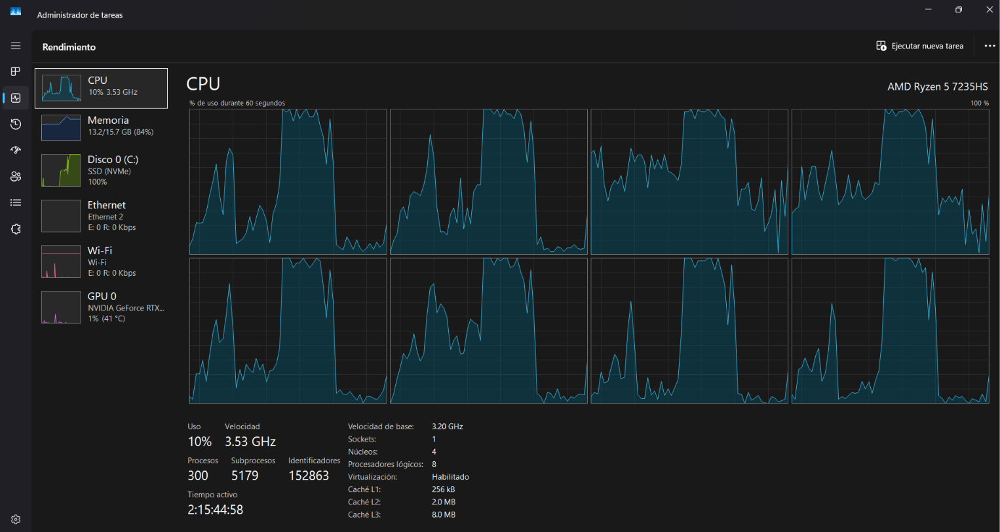

# 5. Implementación con CUDA Python

## 5.1 Entorno de ejecución

Todas las corridas de esta sección y los speedup del informe son de la laptop
de Adrian, la única del equipo con GPU NVIDIA.

| | |
|---|---|
| GPU | NVIDIA GeForce RTX 3050 6GB Laptop GPU (Ampere, capacidad 8.6), 20 SM, 6 GB de VRAM, límite de 95 W |
| Driver y CUDA | Driver 591.66 (CUDA 13.1); PyTorch compilado con CUDA 13.0 y cuDNN 9.24 |
| CPU y RAM | AMD Ryzen 5 7235HS, 4 núcleos físicos y 8 lógicos; 15.7 GB de RAM |
| Sistema operativo | Windows 11 (compilación 26300) |
| Software | Python 3.12, PyTorch 2.14.1, Numba 0.68.1, numba-cuda 0.30.4, NumPy 2.4.6 |

Condiciones: conectada a la corriente, perfil de energía de máximo
rendimiento, sin usar la laptop durante la corrida y con las aplicaciones de
segundo plano cerradas en lo posible (en la captura de `nvidia-smi` todavía
aparecen algunas, sin uso apreciable de la GPU). Toda la
secuencia se ejecutó con un solo script (`scripts/corrida_gpu.ps1`), que
además guardó `nvidia-smi` cada segundo en `logs/nvidia-smi.csv`.

Para que el código corriera en la GPU real tuvimos que hacer cuatro ajustes
que no aparecían en el simulador de Numba, donde se había probado:

- **`math.floor` en CUDA devuelve un flotante.** En Python y en Numba para CPU
  devuelve un entero, así que el kernel indexaba la imagen con flotantes y no
  compilaba. Se corrigió con `int(math.floor(...))` en `augment.py`.
- **Versiones.** `numba-cuda` 0.30.4 todavía usa `np.row_stack`, que NumPy 2.5
  eliminó; usamos NumPy 2.4. Además, en Windows las bibliotecas de CUDA
  instaladas por pip quedaron en 13.5 mientras PyTorch carga su propio
  nvJitLink 13.0, y el enlazado del kernel fallaba; las fijamos en 13.0.
- **Una prueba que comparaba mal.** `CpuFeeder` reutiliza su buffer de salida
  en cada lote, y la prueba que lo comparaba contra `CudaFeeder` guardaba
  todos los lotes en una lista: todos terminaban apuntando al último. Se
  corrigió clonando cada lote en `tests/test_gpu.py`.
- **`channels_last` desactivado.** En esta GPU hacía el entrenamiento casi 8
  veces más lento (sección 5.3), así que la configuración final usa precisión
  mixta sin ese formato.

## 5.2 Componentes CUDA utilizados

| Componente | Librería | Dónde se usa |
|---|---|---|
| Kernel de entrada (`warp_kernel`) | Numba CUDA (`numba-cuda`) | `augment.py`, lanzado desde `feeders.py` |
| Interoperabilidad Numba ↔ PyTorch | `__cuda_array_interface__`, `cuda.external_stream` | `feeders.py` |
| Memoria pinned y copias asíncronas | PyTorch (`pin_memory`, `non_blocking=True`) | `feeders.py` |
| Eventos CUDA (sincronización y tiempos) | `torch.cuda.Event`, `numba.cuda.event` | `feeders.py`, `bench.py` |
| Convoluciones y productos matriciales | cuDNN y cuBLAS a través de PyTorch | `train.py` |
| Precisión mixta | `torch.autocast`, `torch.amp.GradScaler` | `train.py` |
| Telemetría de la GPU | NVML (`nvidia-ml-py`) y `nvidia-smi` | `monitor.py`, `scripts/corrida_gpu.*` |

El único código CUDA escrito por nosotros es el kernel de entrada; la red usa
las bibliotecas de NVIDIA a través de PyTorch. Así se reparte el trabajo de
un lote de entrenamiento:

1. **CPU, `CudaFeeder.__iter__`.** Toma los índices del lote, ya barajados, y
   copia esas 64 imágenes desde la caché en disco (abierta con *memory map*)
   a uno de los dos buffers *pinned* de 7.7 MB. Antes espera el evento CUDA
   de ese buffer, que indica que su copia anterior ya terminó. Después genera
   en el CPU los 16 parámetros de cada imagen (`sample_params` en
   `augment.py`).
2. **Copia H2D.** `.to(device, non_blocking=True)` encola la copia del
   buffer y de los parámetros en el stream de PyTorch y vuelve de inmediato. Como la memoria es
   *pinned*, la copia la hace el motor DMA de la GPU sin pasar por el CPU.
3. **Kernel.** `launch_warp` lanza `warp_kernel` con bloques de 16 × 16 y un
   grid de 14 × 14 × 64 en el mismo stream, así que empieza solo cuando la
   copia termina. Escribe directamente en un tensor de PyTorch (en el formato
   normal NCHW, porque `channels_last` quedó desactivado), que Numba ve como
   arreglo de dispositivo con `cuda.as_cuda_array(..., sync=False)`.
4. **Red.** El forward y el backward en precisión mixta se encolan en el
   mismo stream y leen ese tensor sin copias. El CPU ya volvió al paso 1 con
   el lote siguiente y el otro buffer.

El CPU solo se detiene una vez por época, para leer la pérdida y la exactitud
acumuladas en la GPU. El tiempo que pasa armando lotes queda como
`data_wait_seconds` en el historial de cada entrenamiento.

## 5.3 Tiempos medidos en GPU

### Transformación de entrada

: Transformación de entrada de 1,160 imágenes (media de 5 repeticiones). El speedup es contra torchvision con PIL.



{width=80%}

El kernel solo, con bloques de 16 × 16, procesa 161,264 imágenes por
segundo, 647 veces lo que hace torchvision con PIL y 81 veces el mismo cálculo
con Numba en los 8 hilos del CPU. Cuando se cuentan también las copias de ida
y vuelta, el rendimiento baja a 10,887 imágenes por segundo:

: Costo de las copias entre CPU y GPU para un lote.



Copiar las 1,160 imágenes en `uint8` toma 11 ms (unos 0.6 ms por lote de
64), y en `float32` ya transformadas unos 55 ms en las repeticiones normales,
5 veces más (la media de la tabla sube a 87 ms por una repetición de 215 ms).
En la variante con copias de ida y vuelta, el kernel es apenas 7 de los 107
ms: la mayor parte es regresar el tensor `float32` al CPU. En el
entrenamiento esa copia de regreso no existe, porque el tensor se queda en la
GPU y lo lee la red directamente.

### Paso de entrenamiento

: Paso de entrenamiento de 15 lotes de 64 (media de 5 repeticiones). El speedup es contra PyTorch en 1 hilo de CPU.



{width=80%}

Las variantes de GPU agregan una optimización a la vez, así que se puede ver
cuánto aporta cada una. `cudnn.benchmark` no cambió nada (0.475 contra 0.474
s). `channels_last`, que en el diseño (sección 4.5) era parte de la
propuesta, hizo el paso casi 8 veces más lento: de 0.474 a 3.777 s. La causa
más probable es que MobileNetV3-Small está hecha casi toda de convoluciones
*depthwise* y de 1 × 1 con pocos canales, y para esas capas cuDNN no tiene en
esta GPU una versión rápida en formato NHWC. La precisión mixta sí ayudó:
sin `channels_last` el paso bajó de 0.475 a 0.356 s (25 % menos), y con él
solo de 3.777 a 3.254 s. Por eso la propuesta final es precisión mixta en el
formato normal; con ella el paso es 37 veces más rápido que en un hilo de CPU
y 19 veces más rápido que con los 8 hilos. La medición que nos llevó a
cambiarlo, con las cuatro combinaciones, está en
`results/adrian-rtx3050/logs/medir_layout.log`.

### Inferencia

: Inferencia por lotes de 64 y latencia de una sola imagen.



Por lotes de 64, la GPU con precisión mixta clasifica 5,998 imágenes por
segundo, 31 veces más que un hilo de CPU. Con una sola imagen la situación se
invierte: la GPU tarda 8.5 ms y un hilo de CPU 6.2 ms, porque con tan poco
trabajo pesa más lanzar decenas de kernels pequeños que el cálculo mismo.

### Entrenamientos completos

: Entrenamientos completos con las 43,500 imágenes de la partición de entrenamiento.



`base-cuda` es la receta del Lab 3 completa en GPU y `robusto-cuda` la
variante con aumentación más fuerte (sección 4.6). `base-cuda-aug-cpu` es la
misma receta con la transformación de entrada en el CPU, cortada a 2 épocas;
`base-cpu-1epoca` es una época de la receta completa solo en CPU, que sirve
para comparar épocas reales y no solo pasos aislados.

Con la transformación en GPU la red esperó por datos el 21.0 % del tiempo
de entrenamiento; con la transformación en el CPU, el 64.5 %, y la época tardó
58.3 s contra 28.0 s (2.1 veces más). El 21 % de `base-cuda` está inflado por
la primera época, que leyó la caché del disco por primera vez y esperó 31 s;
de la segunda en adelante la espera fue de unos 3.3 s por época, cerca de 13
%. Esta es la comprobación directa de la hipótesis 5 de la sección 3. Las
dos corridas llegaron al mismo macro F1 de validación en la segunda época
(0.9454 y 0.9456), lo que confirma que el kernel en GPU y el de CPU hacen la
misma transformación y solo cambia el tiempo.

{width=85%}

## 5.4 Configuración de hilos por bloque

Repetimos con el kernel el ejercicio de clase de variar los hilos por bloque.
El cálculo es el mismo; solo cambia cómo se agrupan los hilos.

: Kernel de entrada con distintos tamaños de bloque (1,160 imágenes, sin copias).



{width=65%}

El más rápido fue 16 × 16 (0.379 ms por lote), pero 8 × 8, 16 × 8 y 32 × 8
quedaron a menos de 3 %: el kernel está limitado por memoria y, mientras haya
suficientes warps en vuelo para esconder la latencia, la forma del bloque casi
no importa. Con 32 × 32 = 1,024 hilos fue 15 % más lento. En esta GPU cada SM
admite hasta 1,536 hilos, así que con bloques de 256 caben 6 bloques y el SM
queda lleno, pero con bloques de 1,024 solo cabe uno y un tercio del SM queda
sin usar. No es por los bordes: 224 es múltiplo de 16 y de 32. La fila de
32 × 16 no es confiable: sus 5 repeticiones fueron de 7 ms (igual que las
demás) a 171 ms, con un CV de 73 %, y en la primera corrida del benchmark
también salió ruidosa; lo atribuimos a otra carga en la GPU durante esa
medición y no a la configuración.

También variamos el tamaño de lote del entrenamiento en GPU:

: Paso de entrenamiento en GPU con precisión mixta según el tamaño de lote.



El rendimiento sube de 1,298 imágenes por segundo con lotes de 32 a 3,744
con 128, y con 256 ya no mejora (3,691): con lotes pequeños la GPU no tiene
suficiente trabajo por kernel. `base-cuda` usó como máximo 750 MB de los 6 GB,
así que la memoria no fue límite. Mantuvimos 64 para que la receta sea la
misma del Lab 3.

## 5.5 Evidencia de uso de recursos

Las capturas se tomaron durante la corrida oficial; los registros de texto
completos están en `results/<equipo>/logs/`.

{width=90%}

{width=90%}

{width=90%}

{width=90%}

{width=90%}

{width=90%}

Además de las capturas, un monitor propio (`monitor.py`) registró el uso de
cada núcleo (cada 0.25 s en las mediciones y cada 0.5 s en los
entrenamientos) y, con NVML, el uso, la memoria, la potencia y la
temperatura de la GPU durante todas las mediciones:

{width=95%}

{width=95%}

{width=95%}

Durante `base-cuda` la GPU estuvo en promedio al 50 % (el promedio incluye
la validación y los cambios de época), con una mediana de 2,010 MHz y 39 W, y
el CPU al 43 %. Con la transformación en el CPU la GPU bajó a 30 %, con una
mediana de 802 MHz y 11 W, mientras el CPU estuvo al 95 %: la GPU pasa la
mayor parte del tiempo esperando, y hasta baja su frecuencia.
