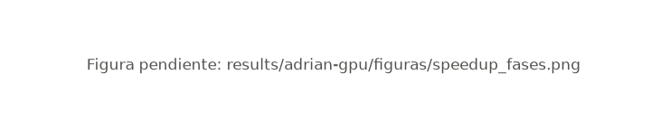
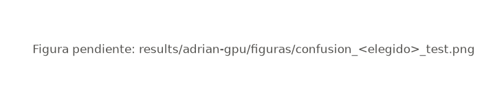

# 6. Análisis y conclusiones

## 6.1 Comparación de tiempos por fase

La tabla resume cada fase en la laptop oficial: el tiempo por imagen de la
versión secuencial, de la mejor variante en CPU multinúcleo y de la variante
propuesta en GPU. Usamos milisegundos por imagen porque no todas las fases
procesan la misma cantidad de imágenes.

: Tiempo por imagen y speedup por fase en la laptop oficial. La decodificación no tiene variante en GPU porque se queda en el CPU por diseño.



{width=85%}

[[GPU: 3–4 oraciones leyendo la tabla de arriba hacia abajo: qué fase ganó
más con la GPU, cuál ganó más con el CPU multinúcleo y en cuál el CPU
multinúcleo no ayudó o empeoró.]]

{width=85%}

## 6.2 Speedup

Para el entrenamiento completo, la proyección de la sección 2.2 da
[[GPU: horas totales de "Lab 3 secuencial" en proyeccion_entrenamiento.md]]
horas para la versión original en un hilo y [[GPU: horas o minutos de
"Híbrido GPU, kernel CUDA (propuesta)"]] para la propuesta, incluido el
tiempo de armar la caché una vez. El entrenamiento real `base-cuda` tardó
[[GPU: "Total (min)" de base-cuda en entrenamientos.md]] minutos, contra los
13,414 s (3.7 h) que reportó el Lab 3 en CPU. Esta última comparación no es
del todo justa, porque el Lab 3 corrió en otra computadora y con una
búsqueda de 8 configuraciones; la que sí lo es, misma máquina y misma
receta, es la de la tabla anterior.

El speedup de la época completa es menor que el de cada fase por separado.
Es lo que predice la ley de Amdahl: cuando la red se vuelve
[[GPU: speedup de "Paso de entrenamiento" en fases.md]] veces más rápida,
las partes que no se aceleraron igual (armar los lotes en el CPU, la
validación, sincronizar al final de cada época) pasan a ser una fracción
mayor del total. [[GPU: con `data_wait_seconds` de base-cuda, dar qué
fracción de la época quedó en el CPU.]]

Contrastamos las hipótesis de la sección 3 con lo medido:

| Hipótesis | Resultado | Evidencia |
|---|---|---|
| 1. Eliminar la decodificación repetida reduce el tiempo por época aun sin GPU | [[GPU]] Parcial en la M3: la parte de datos bajó de 1.84 s a 0.36 s por época de 1,160 imágenes, pero la época total no, porque ahí domina la red | `bench_pipeline.csv`, columna `data_seconds` |
| 2. La decodificación escala casi lineal hasta los núcleos físicos y después se aplana | [[GPU]] En la M3 se aplanó en 4 procesos (1.98×), con Karp-Flatt creciente | `prep.md` |
| 3. El kernel en GPU es al menos 10 veces más rápido que torchvision/PIL | [[GPU]] | `augment.md` |
| 4. El paso de entrenamiento en GPU con AMP es más de 10 veces más rápido que en CPU multinúcleo | [[GPU]] | `train.md` |
| 5. Con la transformación en CPU la GPU queda esperando datos | [[GPU]] | `entrenamientos.md`, `monitor_base-cuda-aug-cpu.png` |

## 6.3 Causas de las diferencias de rendimiento

**La red es donde está el tiempo y es el tipo de cálculo para el que existe
la GPU.** Cada imagen pide unos 0.11 GFLOP en el forward y cerca del doble en
el backward, organizados en convoluciones y productos matriciales con miles
de salidas independientes. cuDNN reparte ese trabajo entre todos los
multiprocesadores de la GPU, y con precisión mixta además usa los Tensor
Cores. En el CPU el mismo trabajo se reparte entre unos pocos núcleos, y como
vimos en la M3, repartirlo entre más hilos no siempre ayuda.

**El kernel de entrada está limitado por memoria, no por cálculo.** Cada hilo
hace unas 60 operaciones de punto flotante por 24 bytes que lee y escribe.
Por eso el tamaño de bloque importa poco mientras haya suficientes warps en
vuelo para esconder la latencia de memoria (sección 5.4), y por eso la
ventaja contra el CPU viene sobre todo del ancho de banda de la memoria de la
GPU. [[GPU: confirmar con kernel_bloques.md.]]

**La copia por PCIe es el costo que se paga por usar la GPU.** Mandar `uint8`
de 200 × 200 en lugar de `float32` de 224 × 224 reduce cinco veces lo que
cruza el bus, y como la copia es asíncrona desde memoria *pinned*, se traslapa
con el cálculo del lote anterior. [[GPU: tiempo de copia de un lote uint8
frente a float32, de transferencias.md.]]

**El CPU no puede quedarse atrás.** Con la transformación en la GPU, al CPU
le queda solo copiar lotes desde la caché y generar 16 números por imagen.
Cuando la transformación vuelve al CPU (ablación `base-cuda-aug-cpu`), el CPU
es el que marca el ritmo. [[GPU: img/s y espera por datos de las dos
corridas.]]

**Los hilos de PyTorch en CPU.** En la M3, con 8 hilos, el paso de
entrenamiento fue 2.9 veces más lento que con uno, y durante la época
completa el uso total del CPU promedió entre 31 y 33 %. PyTorch divide cada operación en partes iguales y espera a que
terminen todas; con núcleos de dos velocidades los rápidos esperan a los
lentos en cada capa. [[GPU: comparar con la fila "CPU N hilos" de train.md
en la laptop oficial: si allí sí ayudó, la diferencia es la arquitectura del
procesador.]]

## 6.4 Discusión técnica

### ¿Por qué es más eficiente procesar las imágenes con los núcleos del CPU y delegar exclusivamente la matemática de la red neuronal a la GPU?

Porque son dos tipos de trabajo con necesidades opuestas, y cada procesador
es bueno en uno.

Preparar una imagen significa leer un archivo del disco y decodificar un
JPEG. La GPU no tiene acceso al sistema de archivos: cualquier byte que
procese tiene que pasar primero por el CPU. Además, la decodificación Huffman
de un JPEG es secuencial dentro de cada archivo, porque no se sabe dónde
empieza un símbolo hasta decodificar el anterior, y está llena de ramas; en
una GPU los hilos de un warp que toman caminos distintos se ejecutan por
turnos. Lo que sí es paralelo es que los archivos no dependen entre sí, y eso
es exactamente lo que aprovechan varios procesos del CPU: en la M3 la
decodificación llegó a 1.98 veces con 4 procesos y en la laptop oficial a
[[GPU: mejor speedup de prep.md]]. Además, al guardar el resultado en una
caché `uint8`, la decodificación se hace una sola vez: de las 1,911,100
decodificaciones que hizo la búsqueda del Lab 3 pasamos a 66,700.

La red, en cambio, es aritmética densa y regular: convoluciones y productos
matriciales, unos 56 millones de multiplicaciones-suma por imagen solo en el
forward, todos con el mismo patrón y sin decisiones que dependan de los
datos. Ese es el caso ideal para miles de hilos haciendo la misma operación
sobre datos distintos. El paso de entrenamiento en GPU fue
[[GPU: speedup de la variante propuesta en train.md]] veces más rápido que
en un hilo de CPU y [[GPU: cociente contra "CPU N hilos"]] veces más rápido
que con todos los hilos.

El reparto también reduce lo que hay que mover entre los dos. El CPU manda
`uint8` de 200 × 200 (7.7 MB por lote) y la GPU genera el tensor `float32` de
224 × 224 (38.5 MB) ya en su memoria: cinco veces menos tráfico por PCIe que
si el CPU mandara el tensor listo. Y la prueba de que el reparto importa está
en la ablación: cuando la transformación de entrada se hace en el CPU, la red
esperó [[GPU: espera por datos de base-cuda-aug-cpu]] % del tiempo por
datos, contra [[GPU: base-cuda]] % con la transformación en la GPU.

### ¿Cómo cambió CUDA el tiempo de procesamiento?

[[GPU: 2 párrafos con los números de la corrida oficial:
- speedup del paso de entrenamiento (train.md), de la época completa
  (pipeline.md) y de la proyección del entrenamiento completo
  (proyeccion_entrenamiento.md) contra las 3.7 h del Lab 3;
- qué permitió en la práctica: entrenar y comparar dos recetas completas
  (base y robusta) en minutos, algo que en CPU tomaba horas por receta.]]

### ¿Qué factores justifican o limitan el uso de CUDA?

Lo justifican el volumen y la regularidad del trabajo. Con lotes de 64
imágenes de 224 × 224, el kernel de entrada lanza 3.2 millones de hilos por
lote y la red hace unos 20 GFLOP por paso (forward y backward); con ese tamaño, el costo fijo
de lanzar un kernel o de copiar un lote se reparte entre mucho trabajo útil.

Lo limitan varios factores que medimos:

- **Copias entre CPU y GPU.** [[GPU: dato de transferencias.md.]] Por eso el
  diseño no regresa nunca el tensor al CPU.
- **Lotes pequeños.** Con una sola imagen la GPU tardó
  [[GPU: latencia p50 de GPU para 1 imagen]] ms contra
  [[GPU: CPU 1 hilo]] ms en el CPU: lanzar decenas de kernels cuesta más que
  el cálculo. Para la demo con cámara la GPU sigue sirviendo porque el
  objetivo son unos 30 cuadros por segundo, no la latencia mínima.
- **Memoria de la GPU.** [[GPU: memoria pico de base-cuda y lote máximo
  probado en train_lote_gpu.md.]]
- **Potencia y temperatura de una laptop.** [[GPU: potencia máxima y
  temperatura máxima de nvidia-smi.csv durante 03-train-base; si el reloj de
  la GPU bajó, decirlo.]]
- **Calentamiento.** La primera ejecución compila el kernel de Numba y deja
  que cuDNN pruebe algoritmos; por eso medimos con una ejecución descartada.
  En un entrenamiento de varios minutos ese costo no se nota, en una prueba
  de pocos lotes sí.
- **Dependencia del hardware.** El código CUDA solo corre en GPU NVIDIA. Por
  eso mantuvimos la misma función por píxel compilada también para CPU: el
  proyecto funciona en cualquier computadora, solo que más lento.

## 6.5 Desempeño con datos nuevos

Que el modelo sea rápido de entrenar no sirve si solo funciona con las fotos
del dataset. Lo probamos en tres niveles:

1. **Test interno:** 11,600 imágenes de ventanas de los videos que el modelo
   nunca vio, con la misma persona y el mismo fondo.
2. **Dataset externo** `danrasband/asl-alphabet-test`: 870 fotos de otras
   manos, fondos e iluminación. Lo partimos en dos mitades por clase. La
   mitad "selección" sirvió para elegir entre las dos recetas y la mitad
   "final" se evaluó una sola vez con el modelo elegido.
3. **Fotos del equipo:** una foto por clase de cada integrante, tomadas con
   celular o laptop en el lugar donde estuviéramos.

: Métricas de los dos modelos entrenados en GPU sobre el test interno y el dataset externo.



[[GPU: 2 oraciones: qué receta eligió `seleccion_modelo.json` y con qué
macro F1 en la mitad "selección"; y el macro F1 del modelo elegido en la
mitad "final".]]

: Modelo elegido evaluado con las fotos del equipo.



{width=70%}

{width=70%}

[[Fotos: 1 párrafo con lo que se vio en `fotos-*_predictions.csv` y
`top_confusions` de los JSON: qué letras se confunden (en el piloto las más
frecuentes fueron R con U, N con M, U con V y P con Q: pares de señas que
solo cambian en la posición de uno o dos dedos), si las
confusiones de las fotos coinciden con las del test interno, y si los
errores se concentran en fotos con fondo o luz muy distintos.]]

La diferencia entre el test interno y los datos nuevos es el cambio de
dominio: el dataset de entrenamiento tiene una sola persona, un solo fondo y
una iluminación parecida en todos los frames. Una partición correcta (por
ventanas de video, sin archivos repetidos entre particiones) evita inflar el
test interno, pero no puede inventar variedad que el dataset no tiene. La
receta con aumentación más fuerte ataca ese problema desde el entrenamiento,
y solo fue práctica de probar con datos completos gracias a la GPU.

## 6.6 Conclusiones

[[GPU: 6–8 oraciones, una por hallazgo y cada una con su número. Guía:
1. Speedup de la época completa y del entrenamiento completo en la misma
   máquina.
2. La decodificación paralela en CPU: speedup, dónde se aplanó y por qué
   (Karp-Flatt creciente: overhead, no parte serial).
3. Hacer la decodificación una sola vez: de 1.9 M a 66,700.
4. El kernel propio: speedup contra PIL y contra Numba en CPU; mejor tamaño
   de bloque.
5. La red con AMP: speedup del paso y qué optimización aportó más.
6. La ablación: la GPU espera si el CPU hace la transformación.
7. Lo que no mejoró: más hilos de PyTorch en CPU (M3) y la latencia de una
   sola imagen en GPU.
8. Datos nuevos: macro F1 en test interno, externo final y fotos del
   equipo.]]
