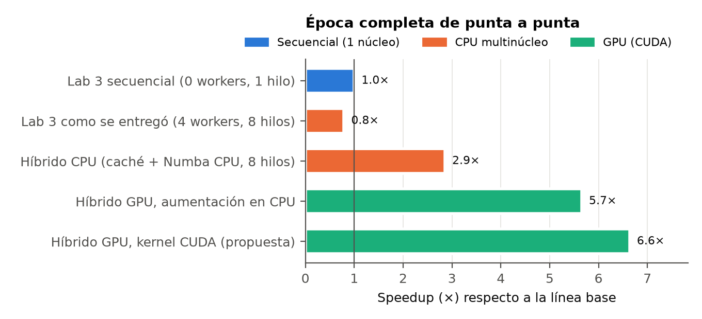
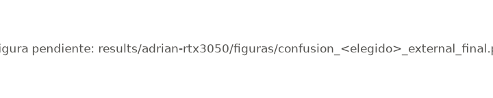

# 6. Análisis y conclusiones

## 6.1 Comparación de tiempos por fase

La tabla resume cada fase en la laptop oficial: el tiempo por imagen de la
versión secuencial, de la mejor variante en CPU multinúcleo y de la variante
propuesta en GPU. Usamos milisegundos por imagen porque no todas las fases
procesan la misma cantidad de imágenes.

: Tiempo por imagen y speedup por fase en la laptop oficial. La decodificación no tiene variante en GPU porque se queda en el CPU por diseño.



{width=85%}

La fase que más ganó con la GPU fue la transformación de entrada: el kernel
la hace 647 veces más rápido que torchvision con PIL. Le siguen la época
completa (39×), el paso de entrenamiento (37×) y la inferencia por lotes
(31×). Con el CPU multinúcleo la que más ganó fue también la transformación
(8.0× con el kernel de Numba en 8 hilos), seguida de la decodificación
(2.16×); el entrenamiento y la inferencia apenas pasaron de 1.9× y 1.8× con 8
hilos. Donde el CPU multinúcleo empeoró fue en la época del Lab 3 tal como se
entregó (0.66×, sección 2) y en la latencia de una sola imagen.

{width=85%}

## 6.2 Speedup

Para el entrenamiento completo, la proyección de la sección 2.2 da 3.0
horas para la versión original en un hilo y 4.6 minutos para la propuesta,
más 1.2 minutos para armar la caché una sola vez. El entrenamiento real
`base-cuda` tardó 5.6 minutos, contra los 13,414 s (3.7 h) que reportó el
Lab 3 en CPU. Esta última comparación no es
del todo justa, porque el Lab 3 corrió en otra computadora y con una
búsqueda de 8 configuraciones; la que sí lo es, misma máquina y misma
receta, es la de la tabla anterior.

El speedup de la época completa (39×) queda entre el de sus partes: por
encima del paso de entrenamiento (37×), porque en la versión original una
cuarta parte de la época era leer y transformar imágenes, y esa parte se
aceleró mucho más que la red, y
muy por debajo de la transformación (647×). Es lo que predice la ley de
Amdahl: lo que no se aceleró igual (armar los lotes en el CPU, la
validación, sincronizar al final de cada época) pasa a pesar más. En
`base-cuda`, de la segunda época en adelante, el CPU tardó unos 3.3 s por
época en armar lotes, cerca de 13 % de la época; aunque la GPU fuera
infinitamente rápida, la época no bajaría de eso.

Contrastamos las hipótesis de la sección 3 con lo medido:

| Hipótesis | Resultado | Evidencia |
|---|---|---|
| 1. Eliminar la decodificación repetida reduce el tiempo por época aun sin GPU | Sí. En la laptop oficial la época bajó de 20.8 s a 9.0 s (2.32×) y la parte de datos de 5.5 s a 0.58 s. También en la Ryzen: la época bajó de 25.8 s a 9.4 s (2.75×) y la parte de datos de 5.4 s a 0.45 s. En la M3 la parte de datos también bajó (1.84 s a 0.36 s), pero la época no, por los hilos de PyTorch | `pipeline.md`, `bench_pipeline.csv` (`data_seconds`) |
| 2. La decodificación escala casi lineal hasta los núcleos físicos y después se aplana | Se aplana, pero no escala casi lineal. En la laptop oficial (4 núcleos físicos) llegó a 2.10× con 4 procesos y 2.16× con 8; la Ryzen (10 núcleos físicos) llegó a su máximo con 8 procesos (3.9×) y bajó con 20; la M3 se aplanó en 4 (1.98×). En las dos Karp-Flatt crece con los procesos | `prep.md` |
| 3. El kernel en GPU es al menos 10 veces más rápido que torchvision/PIL | Sí, por mucho: 647× solo el kernel y 44× contando las copias de ida y vuelta | `augment.md` |
| 4. El paso de entrenamiento en GPU con AMP es más de 10 veces más rápido que en CPU multinúcleo | Sí, 19× contra los 8 hilos, pero solo sin `channels_last`; con ese formato, como estaba en el diseño, fue apenas 2.1× | `train.md` |
| 5. Con la transformación en CPU la GPU queda esperando datos | Sí: la espera por datos sube de 21 % a 64.5 % del tiempo y la GPU baja de 50 % a 30 % de uso medio | `entrenamientos.md`, `monitor_base-cuda-aug-cpu.png` |

## 6.3 Causas de las diferencias de rendimiento

**La red es donde está el tiempo y es el tipo de cálculo para el que existe
la GPU.** Cada imagen pide unos 0.11 GFLOP en el forward y cerca del doble en
el backward, organizados en convoluciones y productos matriciales con miles
de salidas independientes. cuDNN reparte ese trabajo entre todos los
multiprocesadores de la GPU, y con precisión mixta además usa los Tensor
Cores. En el CPU el mismo trabajo se reparte entre unos pocos núcleos, y como
vimos en la sección 2, repartirlo entre más hilos ayuda poco (1.45× con 20
hilos en la Ryzen) o incluso empeora (0.34× con 8 en la M3).

**El kernel de entrada está limitado por memoria, no por cálculo.** Cada hilo
hace unas 60 operaciones de punto flotante por 24 bytes que lee y escribe.
Por eso el tamaño de bloque importa poco mientras haya suficientes warps en
vuelo para esconder la latencia de memoria (sección 5.4), y por eso la
ventaja contra el CPU viene sobre todo del ancho de banda de la memoria de la
GPU. Lo confirma la sección 5.4: entre 8 × 8 y 32 × 8 el tiempo varió menos
de 3 %, y solo con bloques de 1,024 hilos, que dejan un tercio de cada SM
sin usar, se notó la diferencia.

**La copia por PCIe es el costo que se paga por usar la GPU.** Mandar `uint8`
de 200 × 200 en lugar de `float32` de 224 × 224 reduce cinco veces lo que
cruza el bus, y como la copia es asíncrona desde memoria *pinned*, se traslapa
con el cálculo del lote anterior. En la laptop oficial un lote `uint8` tarda
unos 0.6 ms en cruzar y uno `float32` unos 3 ms.

**El CPU no puede quedarse atrás.** Con la transformación en la GPU, al CPU
le queda solo copiar lotes desde la caché y generar 16 números por imagen.
Cuando la transformación vuelve al CPU (ablación `base-cuda-aug-cpu`), el CPU
es el que marca el ritmo: el entrenamiento baja de 1,677 a 748 imágenes por
segundo y la espera por datos sube de 21 % a 64.5 %.

**Los hilos de PyTorch en CPU.** PyTorch divide cada operación en partes
iguales y espera a que terminen todas antes de seguir. En la Ryzen, con 20
hilos, el paso de entrenamiento fue solo 1.45 veces más rápido aunque los 20
hilos lógicos aparecían al 96 %: buena parte de ese uso es espera activa en
las barreras de OpenMP. En la M3, con 8 hilos, fue 2.9 veces más lento que con
uno, con el CPU ocupado apenas entre 31 y 33 %: con núcleos de dos
velocidades los rápidos esperan a los lentos en cada capa. En la laptop
oficial, con 4 núcleos iguales y Windows, 8 hilos dieron 1.93×: más que en
las otras dos, pero lejos de 8. La diferencia entre las tres máquinas es la
arquitectura del procesador, no el código.

## 6.4 Discusión técnica

### ¿Por qué es más eficiente procesar las imágenes con los núcleos del CPU y delegar exclusivamente la matemática de la red neuronal a la GPU?

Porque son dos tipos de trabajo con necesidades opuestas, y cada procesador
es bueno en uno.

Preparar una imagen significa leer un archivo del disco y decodificar un
JPEG. La GPU no tiene acceso al sistema de archivos: cualquier byte que
procese tiene que pasar primero por el CPU. Además, la decodificación Huffman
de un JPEG es secuencial dentro de cada archivo, porque no se sabe dónde
empieza un símbolo hasta decodificar el anterior, y está llena de ramas; en
una GPU los hilos de un warp que toman caminos distintos se ejecutan por
turnos. Lo que sí es paralelo es que los archivos no dependen entre sí, y eso
es exactamente lo que aprovechan varios procesos del CPU: la decodificación
llegó a 3.9 veces con 8 procesos en la Ryzen, a 1.98 con 4 en la M3 y a
2.16 con 8 en la laptop oficial. Con hilos, en cambio,
fue más lenta que la versión secuencial en la Ryzen (0.51×) por el GIL. Además, al guardar el resultado en una
caché `uint8`, la decodificación se hace una sola vez: de las 1,911,100
decodificaciones que hizo la búsqueda del Lab 3 pasamos a 66,700.

La red, en cambio, es aritmética densa y regular: convoluciones y productos
matriciales, unos 56 millones de multiplicaciones-suma por imagen solo en el
forward, todos con el mismo patrón y sin decisiones que dependan de los
datos. Ese es el caso ideal para miles de hilos haciendo la misma operación
sobre datos distintos. El paso de entrenamiento en GPU fue 37 veces más
rápido que en un hilo de CPU y 19 veces más rápido que con todos los hilos.

El reparto también reduce lo que hay que mover entre los dos. El CPU manda
`uint8` de 200 × 200 (7.7 MB por lote) y la GPU genera el tensor `float32` de
224 × 224 (38.5 MB) ya en su memoria: cinco veces menos tráfico por PCIe que
si el CPU mandara el tensor listo. Y la prueba de que el reparto importa está
en la ablación: cuando la transformación de entrada se hace en el CPU, la red
esperó 64.5 % del tiempo por datos, contra 21 % con la transformación en la
GPU.

### ¿Cómo cambió CUDA el tiempo de procesamiento?

En la misma laptop, el paso de entrenamiento pasó de 13.2 s a 0.36 s por 15
lotes (37×) y una época completa de 1,160 imágenes de 20.8 s a 0.53 s (39×).
Proyectado al entrenamiento completo, son 3.0 horas contra 4.6 minutos, y el
entrenamiento real de la receta del Lab 3 en GPU tardó 5.6 minutos, contra
las 3.7 horas que tomó en CPU. Medido con épocas reales de 43,500 imágenes,
la mejor versión en CPU (caché, kernel de Numba y 8 hilos) tardó 242 s por
época y la GPU unos 25 s una vez caliente.

En la práctica, esto cambió lo que pudimos probar. En el Lab 3 una sola
receta tomaba horas, así que no había forma de comparar varias. Aquí
entrenamos dos recetas completas (la base, en 5.6 minutos, y la robusta con
aumentación más fuerte y más capas descongeladas, en 7.1 minutos), las
evaluamos con datos externos y elegimos la mejor, todo en menos de 15
minutos. También pudimos medir decisiones de diseño, como `channels_last`,
en un par de minutos y cambiarlas cuando no funcionaron.

### ¿Qué factores justifican o limitan el uso de CUDA?

Lo justifican el volumen y la regularidad del trabajo. Con lotes de 64
imágenes de 224 × 224, el kernel de entrada lanza 3.2 millones de hilos por
lote y la red hace unos 20 GFLOP por paso (forward y backward); con ese tamaño, el costo fijo
de lanzar un kernel o de copiar un lote se reparte entre mucho trabajo útil.

Lo limitan varios factores que medimos:

- **Copias entre CPU y GPU.** El kernel solo procesa 161,264 imágenes por
  segundo, pero con las copias de ida y vuelta baja a 10,887: el kernel es 7
  de los 107 ms y casi todo lo demás es regresar el tensor `float32` al CPU.
  Por eso el diseño no regresa nunca el tensor al CPU.
- **Lotes pequeños.** Con una sola imagen la GPU tardó 8.5 ms contra 6.2 ms
  en un hilo de CPU: lanzar decenas de kernels cuesta más que el cálculo.
  Con lotes de 32 el entrenamiento rinde 1,298 imágenes por segundo y con 128,
  3,744. Para la demo con cámara la GPU sigue sirviendo porque el
  objetivo son unos 30 cuadros por segundo, no la latencia mínima.
- **Memoria de la GPU.** Con MobileNetV3-Small no fue límite: `base-cuda`
  usó como máximo 750 MB de 6 GB, y lotes de 256 corrieron sin problema. Con
  un modelo más grande, 6 GB sí obligarían a bajar el lote.
- **Potencia y temperatura de una laptop.** Durante `base-cuda` la GPU llegó
  a 76 W y 65 °C, y durante `robusto-cuda` a 78 W y 71 °C, por debajo de su
  límite de 95 W. La mediana del reloj fue de unos 2,000 MHz en las dos, así
  que no vimos que bajara la frecuencia por temperatura en entrenamientos de
  6 a 7 minutos; en uno de horas sí podría pasar.
- **Software y memoria del sistema.** La GPU agrega piezas que deben
  coincidir: tuvimos que fijar NumPy y las bibliotecas de CUDA de pip para que
  el kernel compilara (sección 5.1). Y con solo 16 GB de RAM, preparar la caché
  con 8 procesos dejó 2,294 imágenes en negro sin ningún error. Además, la
  configuración traía `channels_last`, que en esta GPU empeoraba todo.
  Nada de eso aparece en el simulador; hubo que medirlo en el hardware real.
- **Calentamiento.** La primera ejecución compila el kernel de Numba y deja
  que cuDNN pruebe algoritmos; por eso medimos con una ejecución descartada.
  En un entrenamiento de varios minutos ese costo no se nota, en una prueba
  de pocos lotes sí.
- **Dependencia del hardware.** El código CUDA solo corre en GPU NVIDIA. Por
  eso mantuvimos la misma función por píxel compilada también para CPU: el
  proyecto funciona en cualquier computadora, solo que más lento.

## 6.5 Desempeño con datos nuevos

Que el modelo sea rápido de entrenar no sirve si solo funciona con las fotos
del dataset. Lo probamos en dos niveles:

1. **Test interno:** 11,600 imágenes de ventanas de los videos que el modelo
   nunca vio, con la misma persona y el mismo fondo.
2. **Dataset externo** `danrasband/asl-alphabet-test`: 870 fotos de otras
   manos, fondos e iluminación. Lo partimos en dos mitades por clase. La
   mitad "selección" sirvió para elegir entre las dos recetas y la mitad
   "final" se evaluó una sola vez con el modelo elegido.

: Métricas de los dos modelos entrenados en GPU sobre el test interno y el dataset externo.



Con la mitad "selección" del dataset externo se eligió la receta robusta,
con macro F1 de 0.514 contra 0.385 de la base. En la mitad "final", evaluada
una sola vez, el modelo elegido llegó a 0.504, y en el test interno a 0.982
(la base, 0.952). La primera evaluación del test interno había dado 0.78 y
0.81: 2,294 imágenes de la caché de prueba habían quedado en negro (sección
2.5), y los dos modelos daban la misma predicción con la misma confianza para
todas. Reconstruimos la caché y repetimos la evaluación; los modelos no se
volvieron a entrenar, porque las particiones de entrenamiento y validación
estaban bien. En el externo las confusiones más frecuentes del modelo elegido
fueron V con K, M con N, X con R, S con I y A con Y.

{width=70%}

{width=70%}

En la mitad "final" del externo el modelo acertó 229 de 435 fotos (52.6 %),
y en el 73 % de los casos la seña correcta estuvo entre sus tres primeras
opciones. Los errores no se reparten parejo. P, Q, H y L salieron casi
siempre bien (de 13 a 15 aciertos de 15), mientras que V y S no acertaron
ninguna, y E, T, O y X solo 2 de 15. La confusión más frecuente, V con K (13
de 15), es la de dos señas con los mismos dos dedos levantados, en las que
solo cambia dónde va el pulgar; M con N, S con I y A con Y también son pares
que se distinguen por la posición de uno o dos dedos sobre el puño. M con N
aparece igual en el test interno (34 casos), y X, que en el test se
confundía con S, en el externo se confunde con R: el modelo duda entre las
mismas familias de señas, pero el fondo y la mano cambian hacia qué lado se
equivoca. El modelo además "sabe" cuándo duda: la confianza mediana de los
aciertos fue 0.37 y la de los errores 0.19, así que en una aplicación real
se podría pedir otra toma cuando la confianza es baja.

La diferencia entre el test interno y los datos nuevos es el cambio de
dominio: el dataset de entrenamiento tiene una sola persona, un solo fondo y
una iluminación parecida en todos los frames. Una partición correcta (por
ventanas de video, sin archivos repetidos entre particiones) evita inflar el
test interno, pero no puede inventar variedad que el dataset no tiene. La
receta con aumentación más fuerte ataca ese problema desde el entrenamiento,
y solo fue práctica de probar con datos completos gracias a la GPU.

## 6.6 Conclusiones

1. En la misma laptop, la época completa pasó de 20.8 s a 0.53 s (39×) y el
   entrenamiento completo de 3.0 horas proyectadas a 5.6 minutos reales, con
   el mismo macro F1 de validación que el Lab 3 (0.986 contra 0.989).
2. La decodificación en CPU con procesos llegó a 2.16× con 8 procesos en la
   laptop oficial y se aplanó en los 4 núcleos físicos; Karp-Flatt creció de
   0.22 a 0.39, así que lo que limita es el costo de paralelizar y no una
   parte serial.
3. Guardar las imágenes decodificadas en una caché `uint8` bajó las
   decodificaciones de 1,911,100 en la búsqueda del Lab 3 a 66,700; junto con
   el kernel de Numba en CPU, eso bajó la época de 20.8 a 9.0 s sin usar la
   GPU.
4. El kernel propio de Numba CUDA hace la transformación de entrada 647 veces
   más rápido que PIL y 81 veces más rápido que el mismo cálculo en 8 hilos de
   CPU; 16 × 16 fue el mejor bloque, aunque cualquier bloque de 64 a 256 hilos
   quedó a menos de 3 %.
5. El paso de entrenamiento en GPU con precisión mixta fue 37 veces más rápido
   que un hilo de CPU; la precisión mixta aportó 25 %, mientras que
   `channels_last`, que estaba en el diseño, lo hacía casi 8 veces más lento
   con esta red y esta GPU, y lo quitamos.
6. Con la transformación en el CPU la GPU pasó 64.5 % del tiempo esperando
   datos y la época tardó 2.1 veces más: el reparto CPU para archivos y GPU
   para toda la aritmética es lo que hace que la GPU rinda.
7. Más hilos de PyTorch en CPU ayudaron poco (1.93× con 8 hilos en la laptop
   oficial, 1.45× con 20 en la Ryzen) o empeoraron (0.34× en la M3), y con una
   sola imagen la GPU (8.5 ms) fue más lenta que un hilo de CPU (6.2 ms).
8. El modelo elegido llegó a 0.982 de macro F1 en el test interno pero a 0.504
   en fotos externas: el límite ya no es el tiempo de entrenamiento sino la
   poca variedad del dataset, y la receta robusta, que solo fue práctica de
   probar gracias a la GPU, subió el externo de 0.38 a 0.50.
